# w_FloPi

I'm Emil, a student at Bauman Moscow State Technical University. I build web tools that make student life easier and automate repetitive tasks.

[Projects](#projects) · [Activity](#activity) · [All repositories](https://github.com/w-flopi?tab=repositories)

## Projects

- **[StaroSTATT](https://github.com/w-flopi/StaroSTATT)** — a digital logbook for class representatives.
- **[razgruzKA](https://github.com/w-flopi/razgruzka)** — a site for an automation service that builds bots, dashboards, and trackers.

**Stack used in these projects**

## Activity

<picture>
  <source media="(prefers-color-scheme: dark)" srcset="https://raw.githubusercontent.com/w-flopi/w-flopi/snake-output/snake-dark.svg">
  
</picture>

Animated contribution calendar · November 23, 2026 snapshot

